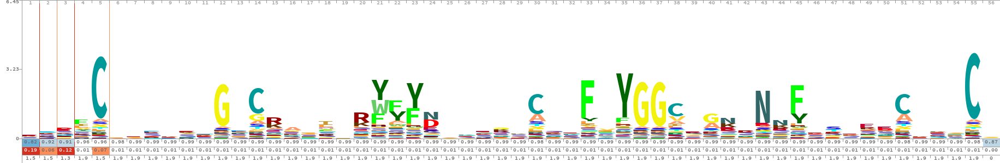
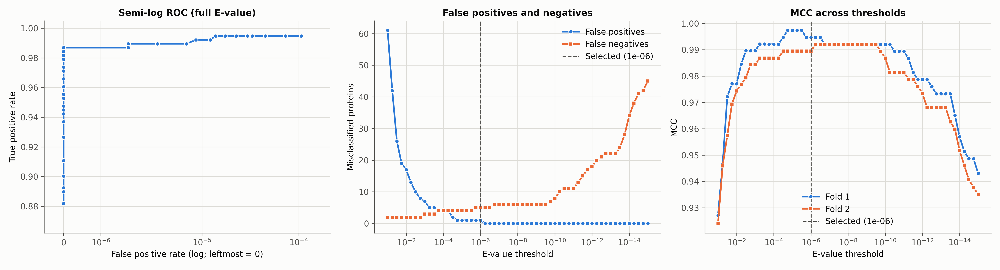
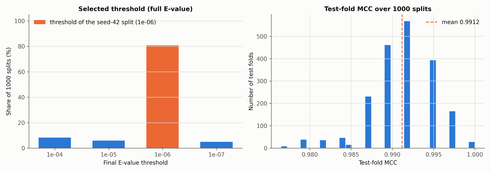

# KunitzHMM

A structure-based profile hidden Markov model (HMM) for the Kunitz/BPTI domain (Pfam [PF00014](https://www.ebi.ac.uk/interpro/entry/pfam/PF00014/)), built from aligned PDB structures and validated on UniProtKB/Swiss-Prot.

Laboratory of Bioinformatics 1, MSc Bioinformatics, University of Bologna. Author: Berkay Oktay Demir.

[](https://colab.research.google.com/github/berkaiser/KunitzHMM/blob/main/kunitz_hmm_pipeline.ipynb)

## Results at a glance

| Step | Result |
|---|---|
| PDB structures (X-ray, ≤ 3.5 Å, 40–80 residues) | 136 Kunitz chains |
| Non-redundant representatives (MMseqs2, 95 % identity, 90 % coverage) | 22 |
| Structural alignment (mTM-align) | TM-score 0.911, RMSD 0.75 Å, no outliers removed |
| Profile HMM | 56 match states, all six cysteines conserved |
| Test set (UniProt release 2026_04) | 381 Kunitz proteins, 575,675 other proteins |
| Selected E-value threshold | 10⁻⁶ (chosen in 81 % of 1,000 random splits) |
| Performance at 10⁻⁶ | 376 / 381 detected, 1 false positive, MCC 0.992 |



*Skylign logo of the 56-state HMM. The most conserved positions are Cys5 and Cys55; the six cysteines at positions 5, 14, 30, 38, 51 and 55 form the domain's three disulfide bonds (5–55, 14–38, 30–51).*

## Pipeline

The whole project runs from one notebook, [`kunitz_hmm_pipeline.ipynb`](kunitz_hmm_pipeline.ipynb). The version in this repository has been run on Google Colab and shows all outputs.

| Step | Folder | What happens |
|---|---|---|
| 00 | `00_data_collection` | RCSB PDB search: Pfam PF00014, data collection resolution ≤ 3.5 Å, polymer entity length 40–80. Hits are returned as polymer entities, so only the Kunitz chain of each structure is kept. |
| 01 | `01_clustering` | MMseqs2 `easy-cluster`, identity ≥ 0.95, coverage ≥ 0.9, `--cov-mode 1`. Sequences are sorted by name first, so the clusters are the same on every run. |
| 02 | `02_structural_alignment` | Each representative chain is downloaded and aligned with mTM-align. Chains with average TM-score ≤ 0.5 or average RMSD ≥ 2 Å would be removed as outliers (none were). |
| 03 | `03_hmm_build` | `hmmbuild` (HMMER 3.4) on the structural alignment. |
| 04 | `04_validation` | Swiss-Prot positives (PF00014) and negatives; positives ≥ 95 % identical to a training sequence are removed with BLAST; `hmmsearch --max -Z 1000`; two-fold cross-validation with MCC-based threshold selection; threshold stability over 1,000 random splits; balanced negative sampling and precision–recall. |

## How to run

### Google Colab

Click **Open in Colab** above and choose **Runtime > Run all**. The first code cell installs HMMER, BLAST+, MMseqs2 and mTM-align (about one minute).

- With `USE_DRIVE = True` in that cell, the project is saved in `MyDrive/kunitz_hmm_project` on your Google Drive and survives the end of the session.
- With `USE_DRIVE = False`, everything is lost when the session ends unless you download it.

A full run from scratch takes about five minutes, most of it the UniProt download and the search of the negative set.

### Your own computer

1. Create the conda environment:

   ```bash
   conda create -n kunitz-hmm -c conda-forge -c bioconda \
       python=3.11 mmseqs2=18.8cc5c hmmer=3.4 "blast>=2.16" \
       numpy pandas matplotlib requests jupyterlab ipykernel
   conda activate kunitz-hmm
   ```

2. Compile mTM-align from source:

   ```bash
   mkdir -p ~/tools && cd ~/tools
   curl -O https://yanglab.qd.sdu.edu.cn/mTM-align/mTM-align.tar.bz2
   tar xjf mTM-align.tar.bz2 && cd mTM-align-code/src
   ```

   On macOS, first replace two Linux-only lines (skip this on Linux):

   ```bash
   sed -i.bak 's/string workdir=get_current_dir_name();/char cwd_buf[4096]; string workdir=getcwd(cwd_buf, sizeof(cwd_buf));/' main.cpp
   sed -i.bak 's/#include <malloc.h>/#include <stdlib.h>/' basic_fun.h
   ```

   Then build it. `make clean` removes the prebuilt Linux binary that comes with the package.

   ```bash
   make clean && make
   ```

   The notebook finds mTM-align through the `MTM` environment variable, the `PATH`, or `~/tools/mTM-align-code/src/mTM-align`.

3. Run the notebook from the repository folder:

   ```bash
   jupyter lab kunitz_hmm_pipeline.ipynb
   ```

## Reproducibility

- **Finished steps are skipped.** Each step writes its results to its folder and is not recomputed if they exist. Set `FORCE = True` in the setup cell to recompute everything.
- **Data versions.** The PDB search was run on 11 November 2026 and the UniProt sets come from release 2026_04. Both databases grow over time. The PDB results are in this repository, so step 00 reuses them. The UniProt FASTA files (about 290 MB) are too large for GitHub and are downloaded again; a newer release can change the counts slightly.
- **Fixed randomness.** The cross-validation folds, the 1,000 stability splits and the 1,000 balanced samples all use seed 42.
- **Comparable E-values.** `hmmsearch -Z 1000` makes E-values independent of the database size.

## Repository structure

```
kunitz_hmm_pipeline.ipynb        the whole pipeline, with outputs
00_data_collection/              PDB search results (CSV, FASTA, entity IDs)
01_clustering/                   MMseqs2 clusters and the 22 representatives
02_structural_alignment/
    round1_all/                  mTM-align output (alignment, superposition, pairwise TM-score and RMSD, log)
    qc_round1.tsv                average TM-score and RMSD per chain
    outliers.txt                 removed chains (empty: none)
    pdb_kunitz_mtm.ali           alignment used to build the HMM
    *.png                        pairwise heatmaps and outlier check
03_hmm_build/
    pdb_kunitz.hmm               the profile HMM
    hmmbuild_summary.txt, hmmstat.txt
    skylign.png                  Skylign logo
04_validation/
    train.fasta                  the 22 training sequences
    train_vs_pos.blast           BLAST of training sequences against the positives
    positives_clean.fasta        the 381 positives used for testing
    classification_*.tsv         E-value, true label and fold for every protein
    *_metrics_by_threshold.csv   metrics at each E-value threshold
    *_threshold_stability.*      1,000-split threshold stability
    *_precision_recall.*         precision–recall on the full and balanced sets
    *_confusion_matrices.png, *_roc_fpfn_mcc.png
```

Files starting with `full_` use the full-sequence E-value (the one reported); files starting with `domain_` use the best-domain E-value.

## Figures



*Left: ROC curve. Middle: false positives and false negatives at each E-value threshold. Right: MCC at each threshold for the two folds. The dashed line marks the selected threshold, 10⁻⁶.*



*Left: how often each threshold was selected in 1,000 random splits. Right: the test MCC of those splits (0.991 ± 0.004).*

## Tools

- RCSB PDB Search and Data APIs
- MMseqs2 (Steinegger & Söding, *Nat Biotechnol* 2017)
- mTM-align (Dong et al., *Bioinformatics* 2018)
- HMMER 3.4 (Eddy, *PLoS Comput Biol* 2011)
- BLAST+ (Camacho et al., *BMC Bioinformatics* 2009)
- UniProtKB/Swiss-Prot (The UniProt Consortium, *Nucleic Acids Res* 2025)
- Skylign (Wheeler et al., *BMC Bioinformatics* 2014)
